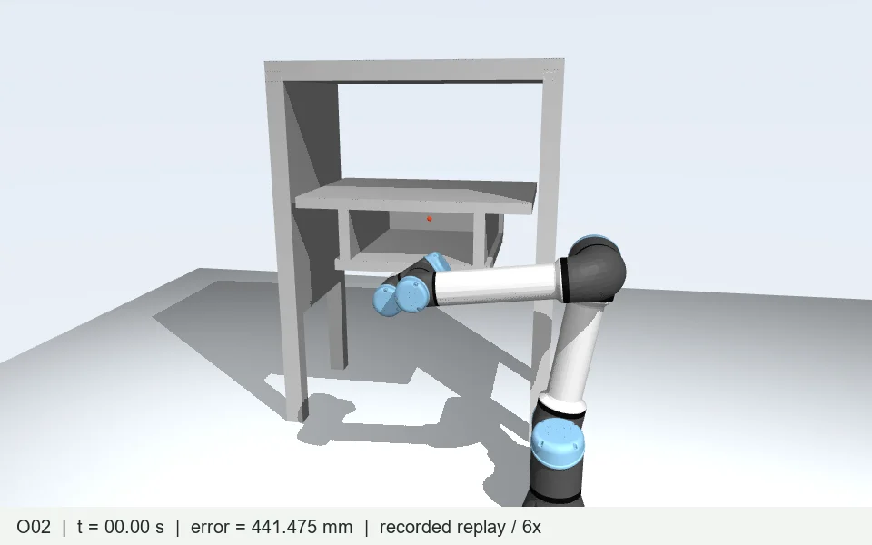

## 论文初稿与实验台账（2026-11-10）

[完整论文 Markdown](docs/library/files/liuqp900/paper-draft.md) · [公式与图表在线版](https://qmoliang.github.io/ur5-cabinet-experiments/library/pages/liuqp900-paper.html) · [历史实验台账](docs/library/files/liuqp900/experiment-ledger.md) · [2000字以内说明](docs/library/files/liuqp900/explanation-under-2000.md)

以冻结提交 `0f40201` 为证据基准，拆分执行器和控制方案的增量，公开全部六个B组失败、回归退化、成本及证明边界。900次主对照加旧在线RRT300条可称1200条所选记录，不是1200个独立场景或同协议四臂；更早批次另列。此次仅补文稿、来源与图表，不改控制代码或原结果。

---

# UR5 Cabinet Experiments

## 900次冻结控制对照与方法稿 — 2026-11-10

**[交互结果与全部900条回放](https://qmoliang.github.io/ur5-cabinet-experiments/liuqp900/)** · **[方法Markdown](docs/library/files/liuqp900/methods.md)** · [证明与边界](docs/library/files/liuqp900/proofs.md) · [源码映射](docs/library/files/liuqp900/code-alignment.md)

15类任务×20个固定输入×3组。C为原LiuQP目标＋原执行方式与安全门，A为原目标＋共同认证执行器，B为终态初始化与新控制＋同一执行器。三组保持相同数值求解配置、输入与原安全标准；每次300秒仿真和1200秒完整墙钟预算。所有失败保留，原实验结果未改写。

| 组 | 物理安全到达 | 完整严格成功 | 完整墙钟中位数 / P90 |
| --- | ---: | ---: | ---: |
| C 原执行方式 | 174/300 | 128/300 | 15.19 / 1057.51 s |
| A 共同执行器 | 186/300 | 186/300 | 41.13 / 184.46 s |
| B 新控制方案 | 294/300 | 294/300 | 144.66 / 352.45 s |

严格成功额外要求全程原QP行、最终制动/静止及适用的记忆审计。C→A严格新增59/退化1，物理安全新增15/退化3；A→B新增109/退化1；C→B严格新增166/退化0，但物理安全仍有1个退化。B不是零代价或无退化方案。

全部900条保存状态可在浏览器播放、逐帧定位，并显示三组同一仿真时刻的误差。回放只计算正运动学，不运行控制器或mj_step。900份轨迹NPZ、审计、事件与失败日志按原字节分包下载；初始化成本、代码冻结哈希、输入来源及逐例源码链接均保留。完整约8.86 GB地图仍在原实验归档，公开哈希与采样可视化；网站不声称包含所有原始地图或已验证干净机器一键重跑。

**与旧RRT队列分开解释：** 原online final_r17的298/300是感知＋RRT规划＋跟踪＋安全门的系统结果。新实验使用其历史观测快照，不是重做同一在线系统。起点/目标可逐例关联，信息、时序及严格验收不同；不能把298→294写成公平回归下降4例。[完整差异说明](docs/library/files/liuqp900/reconciliation.md)

方法稿按最终冻结代码重写，数学证明、条件性执行契约、经验效果及未证明主张分列。已知执行器一致性缺口和有效速度保守性未被隐藏。LaTeX与原始方法资料也可下载，未声称全局收敛、完备逃逸或实机硬实时。[三组贡献与失败](docs/library/files/liuqp900/results.md)

## Paired online and frozen-snapshot study — 2026-11-04

**[Open the updated paired results and performance study](https://qmoliang.github.io/ur5-cabinet-experiments/closeout/study/)**

The sphere ablation is complete: **275/300** safe arrivals versus the reused ellipsoid result **298/300**. Both succeeded in 275 cases, only ellipsoids succeeded in 23, and neither succeeded in 2; no sphere-only successes. The sphere run kept LiuQP, planning/tracking logic, inputs and acceptance rules fixed, propagating the representation switch through view selection, planning, control and certification. No outcome-driven tuning or replacement of failed cases.

An offline study uses 30 preselected saved maps (seed 1 of all 15 tasks from both cohorts) and 90 saved poses. Sphere and ellipsoid proxies have identical cell centers/counts and cover the same saved uncertainty sets. Native C++ linear AABB, scalar MVT and SIMD MVT are checked for identical candidates, QP matrices and commands; a stronger global-AABB/AVX2 linear scan is also tested. All input hashes and the original frozen runtime integrity pass. No new robot trajectories or planner runs were generated for this snapshot study.

The performance numbers measure fixed-pose component workloads, not end-to-end real-time performance. SIMD's incremental contribution is separated from spatial indexing, construction cost and the stronger full-scan reference. The site retains narrow clearance evidence and limitations, including that sampled poses do not prove all 23 closed-loop differences are geometric impossibility.

[IRIS-ZO-inspired screening and region-planning comparison design](https://qmoliang.github.io/ur5-cabinet-experiments/closeout/study/research-design.html) is explicitly **proposed, not implemented or executed**.

## Static study closeout — 2026-11-03

**[Open the final report and MuJoCo replay website](https://qmoliang.github.io/ur5-cabinet-experiments/closeout/)**

| Frozen cohort | Safe arrivals / accepted trials | Scope |
| --- | --- | --- |
| Known map, v5 | 300/300 (100%) | Original criteria, including original 120 s budget |
| Online, final_r17 | 298/300 (99.33%) | Safety and arrival; timing reported separately, 300 s active horizon |

The study is complete. Two online non-arrivals are retained, with no safety or evidence-validity audit errors. No further experiments will be run for this closeout. The goal of all 300 online tasks succeeding was not met. These cohorts have different frozen versions and timing/observation policies: do not pool the rates or treat their difference as a controlled map-knowledge effect. The starts were used during development, so this is a fixed regression study, not held-out generalization evidence.

- Cage seed 8: certified path accepted, tracking stalled, normal operating clearance unavailable; safe stop.
- Drawer seed 20: 31 searches returned no_goal, no accepted path, active horizon exhausted; safe non-arrival. No common specific root cause has been established.

The report preserves the earlier fixed-map factorial comparison and its acceleration-defect caveat, historical dynamic failures, and the original 19-case website/document library. It does not claim universal ellipsoid superiority, real-time guarantees, dynamic safety or hardware readiness.

### Playback, without rerunning experiments

All 600 saved joint/endpoint trajectories are available. Official MuJoCo **3.11.0** WASM recomputes forward kinematics; no controller or physics stepping is run. Three.js displays the original model. Keys **1** physical scene, **2** robot certificate spheres, **3** endpoint trail, **4** sampled published map; mouse orbit/pan/zoom, time scrub, playback speed and case selection are supported. Map samples are visual aids, not complete safety geometry. There are **32 MP4 recordings**: seed 1 of each task/cohort and both online failures. All original saved trajectory frames are retained losslessly.

- [Final online report](docs/closeout/evidence/online-final.json)
- [Known v5 original report](docs/closeout/evidence/known-v5-comparison.json)
- [600-case index](docs/closeout/data.json)
- [Trajectory provenance and hashes](docs/closeout/evidence/replay-provenance.json)
- [Browser checks](docs/closeout/evidence/browser-validation.json)
- [Historical 19-case website](https://qmoliang.github.io/ur5-cabinet-experiments/historical.html)

Preview with `node tools/preview_closeout.cjs`, then open http://127.0.0.1:8765/closeout/. Install the pinned verification dependencies with `npm ci` and run `node tools/check_closeout.cjs` (Chrome required). The website itself serves vendored JS/WASM and needs no build tools or CDN. Export/render tools read the existing source archive only. Full high-volume causal map histories and pair logs remain in the original server archive. Frozen controller code has native/server dependencies; clean-machine rerunning is not validated.

---

Historical 19-case project README (original claims and limitations)

## Historical snapshot

A recorded study of how obstacle representations and online perception affect reaching into a narrow cabinet. The robot uses 65 certificate spheres; environment proxies are spheres or ellipsoids. Controllers include LiuQP and a local position-task adaptation of NEO.

**[Open the interactive experiment website](https://qmoliang.github.io/ur5-cabinet-experiments/)**

**19 attempts · 15 full-duration runs · 4 early terminations.** A completed run is not necessarily a successful reach. Each configuration was attempted once.

## Start here

- Preview the project website: run **python tools/preview.py** from this directory, then open http://localhost:8765.
- [Full experiment overview](reports/experiment-overview.md): measurements, failure mechanisms and the original archive layout.
- [Code map](docs/assets/code-map.md): which component owns each part of the loop.
- [Website metrics](docs/data/experiments.json): all 19 outcomes, error curves and map publication times.
- [Recorded trajectories](evidence/index.json): configuration, completion and timing metadata.
- [Asset and dependency notices](THIRD_PARTY_NOTICES.md).

The website provides synchronized recorded videos, physical/certificate views, a time slider, error curves and result filters. It does not execute a controller in your browser.

## Research documents

[Open the research document library](https://qmoliang.github.io/ur5-cabinet-experiments/library/).

The library contains the user-selected English expanded Word theory guide and 32 original Markdown documents: mathematical derivation, code reading, historical 4.x / 5.x studies, experiment 7, NEO comparisons and current batch reports. Each Markdown has a readable web page with equations, tables and diagrams. Original files are downloadable without byte changes; their provenance and SHA-256 hashes are listed in [the document manifest](docs/library/manifest.json).

- [English expanded Word guide](https://qmoliang.github.io/ur5-cabinet-experiments/library/pages/chapter1-word.html)
- [Ellipsoidal LiuQP derivation](https://qmoliang.github.io/ur5-cabinet-experiments/library/pages/ch02.html)
- [Code reading guide](https://qmoliang.github.io/ur5-cabinet-experiments/library/pages/ch03.html)

Historical versions are labeled separately from the current 19-case batch. Some archive-only paths are retained as text rather than broken web links. One unmatched closing brace in the chapter 2 source is normalized for web typesetting only and noted on the page; the downloadable source remains unchanged.

The committed HTML is generated with **node tools/build_library.mjs**. **tools/collect_library.py** refreshes the chosen originals from the original local workspace; it is not needed to view or rebuild the committed HTML. Rendering components are version-pinned and served locally, with their licenses in docs/library/vendor.

## Main observations

| Configuration | Final position error | Reach confirmed |
| --- | ---: | ---: |
| Known LiuQP, spheres (K01) | 314.165 mm | No |
| Known LiuQP, ellipsoids (K02) | 0.000620 mm | 16.72 s |
| Known NEO, spheres, 46 mm influence (N04) | 312.717 mm | No |
| Known NEO, ellipsoids, 46 mm influence (N02) | 0.000183 mm | 6.04 s |
| Online LiuQP, spheres (O01) | 273.042 mm | No |
| Online LiuQP, ellipsoids (O02) | 0.005167 mm | 21.34 s |
| Online NEO, ellipsoids, no manipulability term (A03) | 0.502953 mm | 6.42 s |

Reach confirmation requires position error below 1 mm for 50 consecutive 20 ms steps. The 46 / 300 mm settings are NEO obstacle influence distances, not proxy radii.

These observations concern this scene and these settings. They do not establish universal ellipsoid superiority or paper-level controller rankings. Online runs follow different trajectories and observe different point clouds.

## Repository layout

    docs/                    Static GitHub Pages site; only this folder is deployed
      assets/                18 short recorded videos, posters, downloadable guides
      data/experiments.json  19-case display data
    experiment/
      batch.py               Schedules the fixed case list
      run_case.py            Selects an isolated runtime and invokes its runner
      runtimes/known/        Known geometry LiuQP / NEO implementations
      runtimes/historical/   Historical 4.3 / 4.4 pipelines
      runtimes/online/       Current perception, controllers and NEO adaptations
      assets/                Canonical scene and UR5 visualization assets
    evidence/<case>/         Saved joint states, error arrays and public metadata
    reports/                 Audit outputs, archive overview, SHA-256 manifest
    tools/                   Website export, public packaging and verification

## What is reproducible here?

The static website works with any local HTTP server and needs no JavaScript build tools.

The third-party quadprog Windows binary is omitted; install quadprog 0.1.13 separately for an appropriate runtime. The public snapshot includes 362 byte-verified files from the formal runtime manifest, scene assets, and joint/error trajectories for all 19 cases. These support source inspection and numerical reanalysis. The full workstation archive also contains large pair tables and causal proxy histories; those are not included in this compact snapshot. Website videos were rendered from those original saved histories at 6 times simulation speed. Online updates are rendered at their recorded publication times.

**A clean-machine controller rerun is not yet validated.** Frozen runtimes include Windows native components, workstation paths and processor-affinity settings. Dependencies and rebuilding require a separate portability pass. The original prepare.py is an archival scene-preparation script, not a public installation command. Do not interpret the source snapshot as a tested one-command reproduction.

The runner applies kinematic joint integration. The recorded clearance audit checks robot certificate spheres against cabinet boxes across recorded intervals. It does not establish continuous self-collision, floor or physical hardware safety.

## Open research issues

- Online map age during control is substantial: median 4.36 s for O01 and 1.80 s for O02.
- MVT uses only layers 4 and 5 in these maps. Assignment combines obstacle AABB extent and the robot query extent; finer indexing alone cannot remove perception delay.
- Current O02 retains very flat ellipsoid cores. Historical 5.1 measurement-support ellipsoids and ET30 minimum-thickness trials are separate experiments, not members of this 19-case batch.
- Online observability conditions still fail. Sphere runs include QP iteration-limit events, and four NEO configurations terminate early.
- NEO here is an adapted position-task implementation, not a full reproduction of its paper.

## Publish with GitHub Pages

1. Create or select the intended GitHub repository and push this directory to its main branch.
2. In the repository, select **Settings → Pages → Build and deployment → Source → GitHub Actions**.
3. Run the **Publish experiment website** workflow (or push a change under docs).

The included workflow uploads only docs. Source, audit and trajectory files remain in the repository. See [GitHub's official workflow documentation](https://docs.github.com/en/pages/getting-started-with-github-pages/using-custom-workflows-with-github-pages).

## Provenance and licensing

The source corresponds to the grounded cabinet rerun dated 2026-09-17. Original frozen hashes are retained in experiment/formal_runtime_manifest.json; reports/public-file-manifest.json covers the copied source and evidence.

Third-party assets and vendored components retain their included licenses. No additional repository-wide license has been selected for the original research code; publication alone does not grant a new blanket license.

