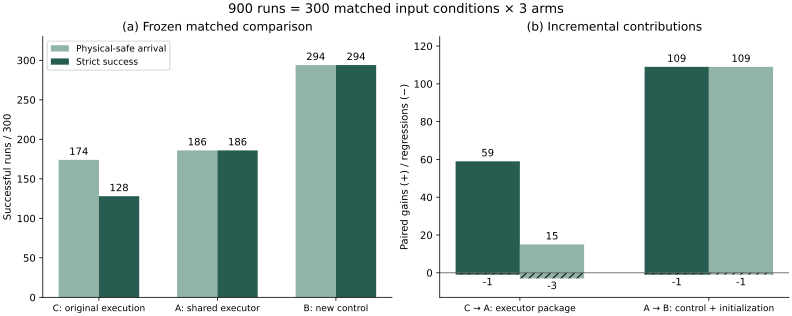
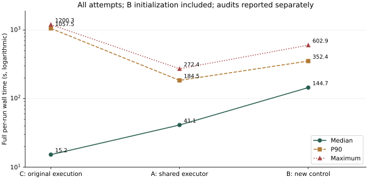

# 面向受约束机械臂到达的认证执行与终态引导持续绕行

**论文初稿，2026-11-10。** 本稿对应已公开冻结版本 `0f402010bb8335df661fdace8745106b7ee5aede`。本次仅整理文稿、统计和图示，没有修改控制代码、输入、成功判据或任何原始结果。作者、单位和投稿 venue 待填写；相关工作与新颖性定位仍需系统补全。

[完整方法及21个编号公式](methods.md) · [条件证明](proofs.md) · [主张—代码映射](code-alignment.md) · [逐任务结果](experiment-tables.md) · [历史实验台账](experiment-ledger.md) · [2000字内讲解](explanation-under-2000.md) · [900次回放](https://qmoliang.github.io/ur5-cabinet-experiments/liuqp900/)

## 摘要

逐时刻满足约束的速度优化，并不自动保证后续仍可执行，也不保证机械臂在非凸障碍环境中持续接近目标。针对本项目 LiuQP 实现中观察到的执行可行性丢失和长期近停滞，本文研究相互分离的执行层与控制层。执行层将实际状态、命令版本、原QP约束和制动续轨迹绑定，通过认证恒速前缀、静止计算等待及备份消费管理延迟。控制层利用有限静态终态假设，改善当前构型至终态固定收缩线的最弱见证余量；必要时转为真正受阻机器人部位的持续切向运动，并以构型重复证据、净目标进展及连续证书决定换向或恢复原任务。每次优化的运动决策变量仍为当前关节速度，控制阶段不调用RRT或搜索航点链，但显式使用静态IK和未来固定线段验证。

在15类任务、每类20个历史输入条件上，冻结三组各300次运行：C为原目标与原执行方式，A为原目标与共同认证执行器，B为终态初始化及新控制与共同执行器。C/A/B的物理安全到达为174/186/294次，严格成功为128/186/294次。C→A严格新增59、退化1；A→B新增109、退化1。B完整单次墙钟中位数144.661秒，明显高于A的41.134秒，不能据成功率改善宣称普遍加速。全部失败、初始化成本及审计均保留。本文证明若干代数性质与明确契约下的证书续接结论；有限预算成功、绕行效果及整体可靠性仅有本批实验支持，不主张全局收敛、完备性或实机硬实时。

**关键词：** 约束速度控制；二次规划；制动证书；终态引导；持续绕行；可追溯实验。

## 1. 问题与研究动机

本项目最早的在线系统将观测建图、认证RRT路径、航点跟踪和执行安全门组合，取得298/300次安全到达。这个系统结果不能证明局部LiuQP本身能解决相同的到达问题。固定地图和既有认证路径上的四条件执行消融进一步发现：LiuQP跟踪与简单关节比例跟踪均4/4通过，后者没有调用QP，且这四条轨迹没有被安全门改写。该证据否定了“这些成功必须依靠LiuQP”的归因，但没有证明简单跟踪器可替代整个300例系统。[历史来源H01](experiment-ledger.md)

移除路径引导后，真实货架输入出现长期近停滞。早期仅末端绕行及姿态调整的最终四条改进运行安全到达0/4；另一次阻塞释放虽从真实停滞状态成功一次，同版本两个重复仍失败。因此，非零速度、局部间隙增大、累计路程增长和最终到达必须分开判断。部分失败还有原速度约束集合为空或数值求解失败，不能全部归称严格局部极小。[H02—H04](experiment-ledger.md)

本文据此研究两个具体问题：第一，如何将当下提案与未来可接受制动、计算等待和实际执行状态一致地连接；第二，如何在安全约束内产生能够跨阻塞部位维持的进展，而非反复回到相邻代理或同一受困构型。它们是本实现中经记录暴露的问题，不被表述成原LiuQP文献在所有平台上的必然缺陷。

本文贡献限定为三个层次：

1. **执行层整体。** 认证原QP行可接受的制动后继、实际命令授权、恒速前缀及计算/反馈时钟管理；明确递归续接所需契约及当前实现例外。
2. **控制层整体。** 有限终态初始化、最弱线余量准备、受阻部位切向传递、构型重复检测和Cartesian净进展恢复门；保留原硬约束与审计标准。
3. **分层证据。** 三组同输入的900次冻结对照，逐例新增与退化、完整耗时、全部失败和历史否定性实验；不将机制触发次数或混合开发记录当作独立因果贡献。

## 2. 与既有方法的关系

Liu与Yim将机械臂操作描述为连续求解的线性约束QP，并在模块化机器人上验证。本文的“LiuQP基线”具体指本仓库的UR5e实现与既定约束、代理几何和数值配置，不等于已逐项复现原文所有平台和实验。[Liu与Yim，2021](https://arxiv.org/abs/2104.02755)

CBF-QP工作将安全约束与性能目标在优化中区分；其不变性结论依赖相应模型、可行性和正则条件。本文同样区分任务效果与可接受动作，但不能将已有CBF定理直接移植为当前离散、延迟、切换及浮点实现的完整保证。[Ames等，2017](https://arxiv.org/abs/1609.06408)

预测安全过滤器也接收外部提案并检查是否可安全执行。本文采用固定制动备份和已认证短恒速段，而非在线优化一般未来状态序列；这种结构差异尚不足以单独证明新颖性或优越性。[Wabersich与Zeilinger，预印本2018](https://arxiv.org/abs/1812.05506)

最终控制有表面跟随、切向持续和历史重复检测，但本文没有给出一般高维Bug型完备性证明。固定终态线验证也不等于全局路径搜索。对相关脱困、导航函数、混合控制和备份证书方法的系统文献比较，以及相同终态信息下的公开基线实验，仍是投稿前工作。

## 3. 问题定义与评价对象

令 $q\in\mathbb R^6$ 为关节构型，$w$ 为上一实际执行速度，$p(q)$ 为末端位置，$p_g$ 为目标。采用运动学反馈：

$$
x_k=(q_k,w_k),\qquad q_{k+1}=q_k+\Delta t\,v_k^{\rm exec},\qquad w_{k+1}=v_k^{\rm exec},\quad\Delta t=0.02\,\mathrm{s}.
$$

原名义速度问题为

$$
\min_{v\in\mathcal C(x_k;\mathcal O)}\tfrac12v^TH_0v+g_0^Tv,\qquad
\mathcal C=\{v:l\le Av\le u\}.
$$

$\mathcal O$ 是历史运动前可用观测发布中选定的冻结地图；原约束覆盖观测障碍、未知前沿、自碰撞、工作空间、关节位置、速度、加速度及制动边界。矩阵随实际状态重建。“保持原约束”指同一状态下不删除或放宽原行，不是保持矩阵数值永远不变。改变目标函数不能使空的 $\mathcal C$ 变为非空。

环境硬余量6 mm、名义工作余量6.5 mm、自碰撞余量5 mm；目标要求误差严格小于1 mm并连续保持50个物理周期。每次上限为300秒仿真和1200秒完整单次计算期限，B的终态初始化计入后者。求解和动作认证等待计入物理时间；独立事后审计单列。名义关节速度与加速度限制不变。完整参数、有效OSQP容差及历史默认值的区别见[方法正文](methods.md)。

模型内证书与真实场景安全也分开。代理外包、机器人覆盖及误差界有效，是将模型认证解释为物理安全所需的额外前提。实验以场景几何独立审计保存轨迹，但没有硬件、接触动力学、模型误差或传感噪声验证。

## 4. 分层方法

### 4.1 执行层：把提案变成可接受的实际动作

执行器在实际状态处认证候选命令及确定性逐关节制动尾；每个后继重建原QP行，并检查物理几何与已提交记忆。证书绑定精确的 $(q,w)$、记忆签名和命令版本，终点必须具有可重复的精确静止见证。零速度不被预设为总是可行。原安全门裁剪或缩放后的真正命令必须有匹配证书；无新授权命令时仅消费现有备份，无可接受备份则失败。

新提案在认证静止状态计算；对同一速度最多认证10个恒速前缀，每个前缀都有可接受制动尾。实测计算时长 $t_c$ 转为 $\max(1,\lceil t_c/\Delta t-10^{-9}\rceil)$ 个调度周期。等待仍消耗物理预算，但不推进反馈停滞计数；反馈计数包括实际动作、制动及零速度反馈，不等于只数非零位移。

它有可观察的行为成本：本批从静止求新命令，在 $a_{\max}=10\,\mathrm{rad}/\mathrm{s}^{2}$ 和20 ms周期下，理想起步及后续保持/制动速度满足各关节 $|v_i|\le0.2\,\mathrm{rad}/\mathrm{s}$。因此执行器不是透明过滤器，C→A同时改变认证、停走及速度保守性，现有对照不能将这些因素再独立拆分。

### 4.2 控制层：终态线准备与持续绕行

首先从有限静态IK候选中选择满足终态位置、关节及几何要求的 $q_g$。在保持两维姿态特征的零空间内，以截断SVD寻找真正可达的局部平移方向，并认证目标附近回退线段。该步骤提供进入方向，不能证明当前状态与终态连通；候选池也不穷尽所有可行终态。

随后检验固定线

$$
\gamma_q(s)=(1-s)q+s q_g,\quad s\in[0,1].
$$

线上的构型是解析评估点，不是被优化的未来状态序列。未能认证时，从违反余量的见证构造 $h_i(q)$ 及梯度 $b_i$，先用原可行集内的辅助LP提高最弱线性预测余量，再产生当前速度提案。准备项使用目标侧支持平面及姿态特征，不能将全部见证行的零空间当成始终保有可用姿态自由度：历史T0失败中，这个见证矩阵接近满秩，投影几乎消掉了姿态任务。

固定线整段通过模型几何与记忆认证后，控制可提出沿 $q_g-q$ 的收缩速度，仍须满足原QP与执行层检查。几何认证并未证明存在符合全部加速度约束的正速度时间参数化；提案级收缩性质也不自动覆盖保持、分量制动和切换后的全部实际轨迹。

准备及实际特征进展持续停滞时，控制转向真正受阻的机器人部位。近表面任务只控制法向修正与切向运动两项，把其余姿态准备放在这个任务的零空间，而非始终要求末端位置不变。跨代理或机器人部位切换时，将旧世界切向投影到新切平面：

$$
\tau_+=\frac{(I-n_+n_+^T)\tau_-}{\|(I-n_+n_+^T)\tau_-\|}.
$$

投影非退化时保留方向连续性；新部位的重试标记单独重置，切换使旧命令失效。若完整构型历史显示同部位、同向运动在足够反馈时间与累计行程后返回旧邻域，则尝试反转切向。历史构型仅用于重复检测，不成为航点、路线或搜索树。

### 4.3 退出绕行与防回陷记忆

“离开某个代理”不足以退出。令开始绕行时的末端位置为 $p_h$，$r_h=\|p_g-p_h\|$，$n_h=(p_g-p_h)/r_h$，并取 $\delta_h=\min(\rho/2,r_h/4)$。定义

$$
\psi_h(q)=n_h^T[p(q)-p_h]-\delta_h.
$$

原任务恢复要求已取得净目标距离改善、满足规定的平面余量，并在停稳后同时认证临时记忆下的零速度备份和具有正目标下降率的原任务提案，才提交记忆。已提交的Cartesian记忆继续参与速度行及连续运动/制动认证。另一种退出是当前至终态整段认证成功，进入终态收缩；并非每次退出都提交新记忆。

该平面保留精确目标位置的所有关节构型，并排除记录位置附近一部分区域，但不保证保留全部1 mm目标球、必要绕行通路或集合连通性。它不能排除在其他区域再次停滞。

### 4.4 保留原QP接口的含义

各阶段可写成带附加目标和附加速度行的凸提案。若辅助最优解为 $v^*$、附加上界行乘子为 $\lambda^*$，则以

$$
\Delta g=\Delta H_\sigma v^*+\Delta g_\sigma+D_\sigma^T\lambda^*
$$

修正原梯度，可在明确KKT条件与 $H_0\succ0$ 下得到同状态的等价唯一解。冻结实现允许复用经残差核验的辅助解；这不是保持原目标不变，也不是每次必做独立的第二次重解。裁剪后的速度还须重新核验和认证。此代数等价不提供脱困、计算更快或后续保持步仍为当前原目标最优的保证。

完整分支、阈值、命令发布顺序及已知执行缺口见[方法正文](methods.md)；证明及适用条件见[证明附录](proofs.md)。

## 5. 理论结论与经验结论的边界

| 主张 | 证据性质 | 本稿允许的结论 | 不允许的外推 |
| --- | --- | --- | --- |
| P1 KKT重写 | 条件代数证明 | 同状态、精确KKT下的解等价 | 原目标未变、必然脱困或更快 |
| P2 秩感知方向 | 条件线性代数证明 | 可达子空间内的局部方向与正确零空间维数 | 有限非线性连通性、所有备用终态同样有效 |
| P3 证书续接 | 依赖契约的归纳证明 | 状态、版本、模型和原子消费一致时的数值可接受续轨迹 | 冻结浮点程序无条件递归可行、无条件实机安全 |
| P4—P6 记忆/曲率/切向 | 明示假设下证明 | 目标纤维保留、给定曲率界的下界、非退化投影不任意反向 | 全目标球与通路保留、全局防循环或浮点无误差 |
| P7—P9 收缩/准备/速度界 | 提案或特定调度条件下证明 | 一步共线收缩、固定见证线性预测、理想0.2 rad/s界 | 整个闭环单调进展、有限预算到达 |
| 294/300、109新增及各机制效果 | 本批实验支持 | 指定历史输入、预算和运行环境中的观察 | 未见世界可靠性、完备脱困、模块独立主效应 |

即使所有单步动作安全，仍可能一直安全地停滞。本文没有共同Lyapunov函数贯穿全部模式的下降证明，也没有一般非凸环境中的有限逃逸或必达定理。

## 6. 实验设计与计数

### 6.1 主实验900次，历史参照另列

主实验是15类任务×20个起点/目标输入编号×3组，共300个配对条件、900次运行。seed在这里是起点表编号，不是300个独立环境或随机路径样本。C为原LiuQP目标、原单步延迟执行和原安全门；A改用共同认证执行器；B在A上增加终态初始化与新控制。三组采用同一冻结输入、机器人、数值求解配置、安全标准与预算，C/A禁止读取B的终态信息。

A/B每对顺序执行并交替先后，C在后续批次补跑。共同机器、每运行四核及相同并发配置降低环境差异，但实测延迟和负载并未完全随机化。A/B的600条记录在C补跑中只读复用；不是又跑了一遍600次。

旧在线RRT系统另有300次，因此可以写“900次控制对照，附300次历史系统参照，共1200条所选运行记录”。四者地图使用、规划参与、计时和验收协议不完全一致，不能写成1200次同协议四臂实验。旧已知场景300次及球表示300次亦独立存在，连同主实验构成至少1800条这些批次的记录；这仍不是全项目历次尝试的穷尽总数。[计数与去重口径](experiment-ledger.md)

### 6.2 双重成功指标与失败保留

物理安全到达要求目标保持、物理安全与预算通过。严格成功另要求每个实际速度符合原QP行验收、末态制动/静止和适用的记忆审计。C没有在线备份，故仅事后从真实末态重建制动尾；缺少在线证书文件本身不被判失败，事后结果也没有反馈给控制器。

全部300次/组进入分母，包括初始化、数值求解、执行协议、安全及预算失败。原始到达、物理安全到达和严格成功分别保留。历史补充证书不倒填原失败标签；固定时序重放、失败快照续跑与未启动取消作业单列。

### 6.3 归因与统计解释

C→A衡量执行层整体在原目标下的增量，A→B衡量终态初始化与控制整体在共同执行器上的增量。缺少“新控制＋原执行器”第四组，也缺少“相同终态初始化＋简单控制”等对照，不能估计全部交互或将收益唯一归到某个公式。机制触发是过程证据，不是消融。

本稿优先报告配对转移、任务分层和耗时分布，不把900条当作900个独立Bernoulli样本给出泛化显著性。主矩阵曾参与开发，早期12对和15对虽在当时按方法留出，后来输入参与修复，不能再次包装为最终版本的全新独立测试集。

## 7. 冻结主实验结果

| 组 | 原始到达 | 物理安全到达 | 严格成功 |
| --- | --- | --- | --- |
| C | 175/300 | 174/300（58.00%） | 128/300（42.67%） |
| A | 186/300 | 186/300（62.00%） | 186/300（62.00%） |
| B | 294/300 | 294/300（98.00%） | 294/300（98.00%） |

图1：左侧分开物理安全到达和严格成功；右侧显示C→A及A→B的新增和退化。所有柱均保留失败分母，不代表独立环境泛化率。

| 比较 | 口径 | 共同成功 | 新增 | 退化 | 共同失败 | 净增 |
| --- | --- | --- | --- | --- | --- | --- |
| C→A | 严格 | 127 | 59 | 1 | 113 | 58 |
| C→A | 物理安全到达 | 171 | 15 | 3 | 111 | 12 |
| A→B | 严格 | 185 | 109 | 1 | 5 | 108 |
| A→B | 物理安全到达 | 185 | 109 | 1 | 5 | 108 |
| C→B | 严格 | 128 | 166 | 0 | 6 | 166 |
| C→B | 物理安全到达 | 173 | 121 | 1 | 5 | 120 |

### 7.1 执行器贡献

严格成功由128增至186，净增58；新增59例中44例原已物理安全到达但原QP/末态备份审计未过，14例原未到达，1例原已到达但物理安全失败。物理安全到达仅净增12（新增15、退化3）。因此，“新增59个严格成功”不等于“多解决59个原本到不了的目标”。

C有161条运行出现实际原QP行违规、7条出现独立LP确认的不可行状态、68条末态原QP固定制动尾未通过；这些集合可重叠，不能相加。A分别为0、0、1，B为0、0、0。这支持执行可接受性的经验改善，但A保留的一致性异常意味着不能声称冻结程序无条件实现了P3契约。[原始审计报告](https://qmoliang.github.io/ur5-cabinet-experiments/library/files/liuqp900/history-evidence/pure300-report.txt)

### 7.2 新控制贡献

A→B物理与严格口径均新增109、退化1、净增108。新增109例全部激活扩展，20例发生表面绕行，只有1例触发构型重复重选。这说明大部分新增成功不能仅归于重复检测或表面绕行；终态准备与进入、执行配合等整体都在作用。

四层货架T0、T2中A各0/20、B各20/20；箱格T1由0/20至18/20；墙体上方两个目标分别由3/20至20/20、1/20至19/20。这些任务分层说明增益集中在哪里，但不是在这些场景上额外调参的授权。[完整15任务表](experiment-tables.md)

### 7.3 完整耗时与收益代价

| 组 | 完整单次中位数/s | P90/s | 最大值/s | 含共享准备计费中位数/s | 终态初始化中位数/s | 事后审计中位数/s |
| --- | --- | --- | --- | --- | --- | --- |
| C | 15.192 | 1057.509 | 1200.305 | 17.753 | 0.000 | 25.679 |
| A | 41.134 | 184.455 | 272.429 | 43.944 | 0.000 | 26.394 |
| B | 144.661 | 352.447 | 602.915 | 146.202 | 79.490 | 12.139 |

图2：全部尝试的完整单次墙钟，采用对数纵轴；包含B初始化，独立事后审计另列。各列中位数不能相加还原另一列中位数。共享输入提取/完整性核验是共同阶段，附加计费列保留其成本，不将其误称每个方法都独立执行一遍。

共同严格成功的127个C/A条件，完整墙钟中位数为3.776→7.832秒；185个A/B共同成功条件为9.131→185.053秒。B初始化中位数79.490秒；全部尝试中B更少长尾失败，不代表简单共同成功案例更快。C的最大1200.305秒包含超时后的收尾，超预算运行不获得成功资格。

A/B正式并行批次106.79分钟，含审计126.37分钟；从输入提取开始至审计完成150.83分钟。C补跑分别112.09、113.09分钟，从预检开始115.87分钟。这些是不同批次的经过时间，不是逐条墙钟之和，也不是可直接加成一次连续900条任务的端到端耗时。[A/B报告](https://qmoliang.github.io/ur5-cabinet-experiments/library/files/liuqp900/history-evidence/paired300-report.txt) · [C报告](https://qmoliang.github.io/ur5-cabinet-experiments/library/files/liuqp900/history-evidence/pure300-report.txt)

## 8. 全部B组失败与关键退化

| B组失败案例 | 末误差/mm | 仿真/s | 完整墙钟/s | 扩展激活 | 绕行次数 | 重复检测次数 |
| --- | --- | --- | --- | --- | --- | --- |
| [drawer s08](https://qmoliang.github.io/ur5-cabinet-experiments/liuqp900/#case=online__drawer__s08&arm=B) | 323.152788 | 300 | 453.513 | 是 | 2 | 0 |
| [drawer s14](https://qmoliang.github.io/ur5-cabinet-experiments/liuqp900/#case=online__drawer__s14&arm=B) | 417.761618 | 300 | 464.987 | 是 | 2 | 0 |
| [iris_bins_t0 s17](https://qmoliang.github.io/ur5-cabinet-experiments/liuqp900/#case=online__iris_bins_t0__s17&arm=B) | 1.380197 | 300 | 160.882 | 否 | 0 | 0 |
| [iris_bins_t1 s13](https://qmoliang.github.io/ur5-cabinet-experiments/liuqp900/#case=online__iris_bins_t1__s13&arm=B) | 339.562401 | 300 | 312.484 | 是 | 1 | 0 |
| [iris_bins_t1 s15](https://qmoliang.github.io/ur5-cabinet-experiments/liuqp900/#case=online__iris_bins_t1__s15&arm=B) | 304.413178 | 300 | 391.550 | 是 | 0 | 0 |
| [wall2_topm15 s11](https://qmoliang.github.io/ur5-cabinet-experiments/liuqp900/#case=online__wall2_topm15__s11&arm=B) | 327.438423 | 300 | 218.003 | 是 | 1 | 0 |

这六例均在300秒仿真预算结束，保存轨迹的物理、原QP可接受性及记忆审计通过；没有被改判成成功。前五例已激活扩展，四例实际进入表面绕行；安全续轨迹和启用绕行都不足以保证预算内到达。记录能证明剩余误差和模式经历，尚不能仅据这些汇总字段唯一确定各例失败根因。

`iris_bins_t0 / seed 17`是唯一A→B退化：A在56.12秒仿真内成功，B停在1.380197 mm，且没有激活新机制。激活门要求误差大于2 mm，到达门小于1 mm；该观测与1—2 mm未覆盖区间相容，但本批没有进行单因素反事实重跑，不能写成已经完成唯一因果证明。C在此物理安全到达，却有10个原QP行违规周期，所以C→B严格统计双方失败，而物理口径仍是退化。

C→A唯一严格退化为`iris_bins_t3 / seed 8`：C在8.16秒成功，A耗尽300秒，B成功。物理口径另有`wall2_topm10 / seed 4`和`exit / seed 5`两例退化。不能用严格口径的“C→B零退化”掩盖物理口径的一例退化。

C的`iris_bins_t0 / seed 6`原始到达但最低环境间隙5.9575 mm低于6 mm，按原标准计安全失败。A的`wall2_topm10 / seed 11`在等待步拒绝前推进内部备份，实际状态未推进，造成末态备份不匹配；实际已执行轨迹安全、原行通过，不能据此认定该状态QP无解。A的`iris_bins_t0 / seed 13`则在认证静止状态达到QP最大迭代数，属数值失败，保留在分母。详细可追溯解释见[实现缺口](author-notes.md)。

## 9. 历史尝试提供什么证据

开发记录用于解释设计选择，不合并成最终方法成功率。以下证据链与对应否定结果同时保留：

| 阶段 | 记录支持的认识 | 必须保留的负面结果 |
| --- | --- | --- |
| 固定路径执行消融 | 系统成功不等于LiuQP不可替代 | 仅4条件，不能推断其余296例 |
| 低维末端/姿态绕行 | 可行瞬时方向不等于释放真正阻塞 | 最终改进0/4；33条开发/筛选记录保留 |
| 单阻塞释放 | 部位与跨周期几何身份重要 | 真实停滞成功1次，同版2次重复失败 |
| 目标端进入与重选向 | 目标侧信息和方向更新有帮助 | 固定快照成功不能代表原始起点；自然延迟仍失败 |
| 整段进入证书 | 准备后认证固定收缩反馈可修复具体失败 | 最终8项7到达，含确定性重复；原始起点仍失败 |
| 目标侧平面与曲率证书 | 固定失败时序下的目标干预、同阈值证书改进有局部因果证据 | 早期v1—v6失败、回归退化均保留；最终12/12是同场景开发验证 |
| 留出与秩修复 | 初始化必须计入总分母，真实秩应决定可达方向 | 早期9/12含3初始化失败；修复旧失败初始化3/3但闭环仅1/3 |
| 四T0分项诊断 | 原行可行性、部位切换与持续进展须分开 | 中间候选快照3/4、原起点3/4、旧成功34/35，未接受替代 |
| 持续绕行与时钟修复 | 运输切向、部位局部重试、反馈时钟与重复检测形成最终组合 | 单独降低退出门等方案未稳定获益；43/43及追加16/16仍是已参与开发的集合 |

其中时钟消融在相同动作段与循环检测下，四个定向条件由2/4至4/4；重复检测生效前4615个反馈状态与无检测版本一致，随后一次重选使具体失败到达。这些强于单纯观察触发次数，但仍只支持对应版本、输入和干预，不证明各机制在900条中的独立效应。[逐批来源、数量及未采用分支](experiment-ledger.md)

历史球/椭球300对照回答几何表示问题，离线IRIS/GCS尝试回答路径覆盖和求路问题；它们不并入局部控制成功率。旧IRIS集成还存在方法/库配置对齐限制，不能用工程小样本否定原方法。最终控制未采用6D探索树、历史回退航点或既有成功路线。

## 10. 局限与投稿前必要补充

**证据独立性。** 正式矩阵是冻结回归而非全新封存测试集；任务共享布局，历史快照和固定时序重复相关。需另建未参与开发的新任务/布局、固定终态信息公平基线及多负载重复，才能支撑更强泛化与时效主张。

**贡献尚未完全拆开。** A将认证、停走、速度保守性和时钟组合；B将静态初始化、目标准备、持续绕行和退出门组合。缺少第四臂及最终版本的系统组件消融。109次机制激活不等于该机制独立创造109个成功。

**理论与程序仍有距离。** P3依赖原子状态更新，A已出现契约例外；P7不覆盖所有保持/制动前缀；P8预测不保证实际长期进展；记忆可能排除必要通路。任何后续修复都须新冻结、新验证，不能把修复后的保证或结果倒填本批。

**终态与触发不完备。** 有限IK候选不穷尽可行终态，重选终态未统一重做初始秩感知过程；1—2 mm激活空档是明确实现边界。终态信息帮助控制但也增加初始化耗时，不能声称只改变一个廉价瞬时梯度就获得全部收益。

**物理与运行范围。** 仅MuJoCo运动学反馈、历史冻结观测；历史地图可能受旧规划系统的观测策略影响。没有动态障碍、在线感知更新、执行误差、扰动、实机安全或硬实时验证。代理、机器人覆盖、曲率和浮点误差契约未被整体形式化验证。

**复现范围。** 已公开900条完整保存轨迹、原始结果/日志/审计、终态输入、冻结源码和哈希。约8.86 GB完整地图仍在原实验归档，公开的是来源、选择规则、哈希与显示采样；目前不声称下载网页即可在干净机器上完整重跑。播放时只做正运动学，没有重新控制或仿真。

## 11. 结论

当前结果支持一个范围明确的判断：在这300个历史输入条件上，认证执行层改善了实际原行与备份验收，新控制及终态初始化在相同执行层上又显著增加了预算内安全到达，代价是额外计算及少量退化。持续绕行与退出机制是有明确设计依据和开发反事实证据的工程方法，尚不是一般脱困完备性定理。论文应以“条件性性质、冻结同输入对照、完整失败与成本披露”为主线，而不是宣称已经普遍解决非凸运动规划或LiuQP的所有缺点。

## 数据、代码与参考文献

- 冻结发布：[0f40201](https://github.com/Qmoliang/ur5-cabinet-experiments/commit/0f402010bb8335df661fdace8745106b7ee5aede)；[方法源码](https://github.com/Qmoliang/ur5-cabinet-experiments/tree/0f402010bb8335df661fdace8745106b7ee5aede/experiment/liuqp900)；[900条索引](https://qmoliang.github.io/ur5-cabinet-experiments/liuqp900/data.json)。
- 完整推导与证据：[方法](methods.md)、[证明](proofs.md)、[性质分类](property-status.md)、[源码映射](code-alignment.md)、[历史台账](experiment-ledger.md)。
- Chao Liu and Mark Yim. *A Quadratic Programming Approach to Manipulation in Real-Time Using Modular Robots*. 2021. [作者预印本](https://arxiv.org/abs/2104.02755)。
- Aaron D. Ames, Xiangru Xu, Jessy W. Grizzle, and Paulo Tabuada. *Control Barrier Function Based Quadratic Programs for Safety Critical Systems*. IEEE Transactions on Automatic Control, 2017. [作者预印本](https://arxiv.org/abs/1609.06408)。
- Kim P. Wabersich and Melanie N. Zeilinger. *A predictive safety filter for learning-based control of constrained nonlinear dynamical systems*. 2018预印本。本文仅据该作者预印本定位结构关系，不把本文执行器说成对其全部理论的实现。[作者预印本](https://arxiv.org/abs/1812.05506)。

以上相关工作属于初步定位，尚不构成完成的新颖性检索或充分的文献实验比较。
